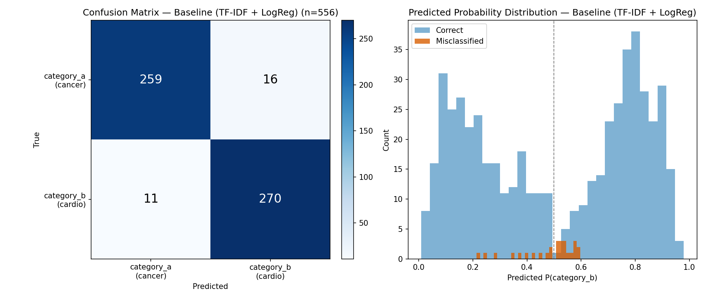
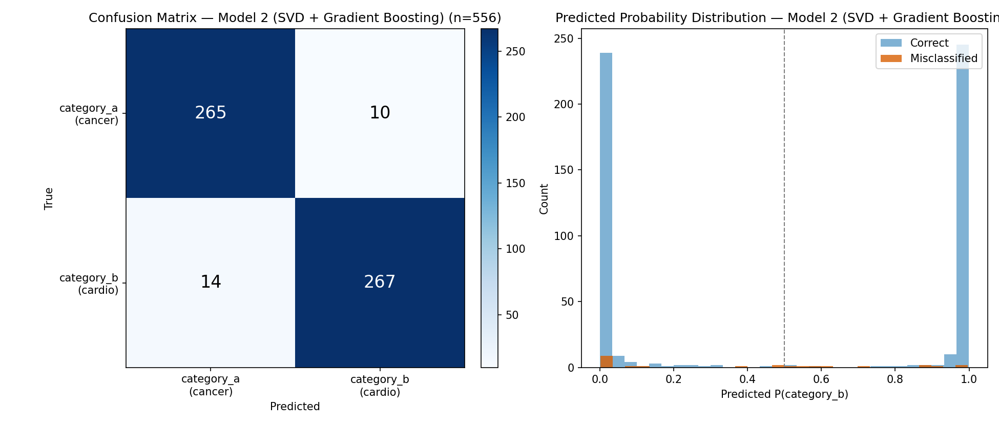
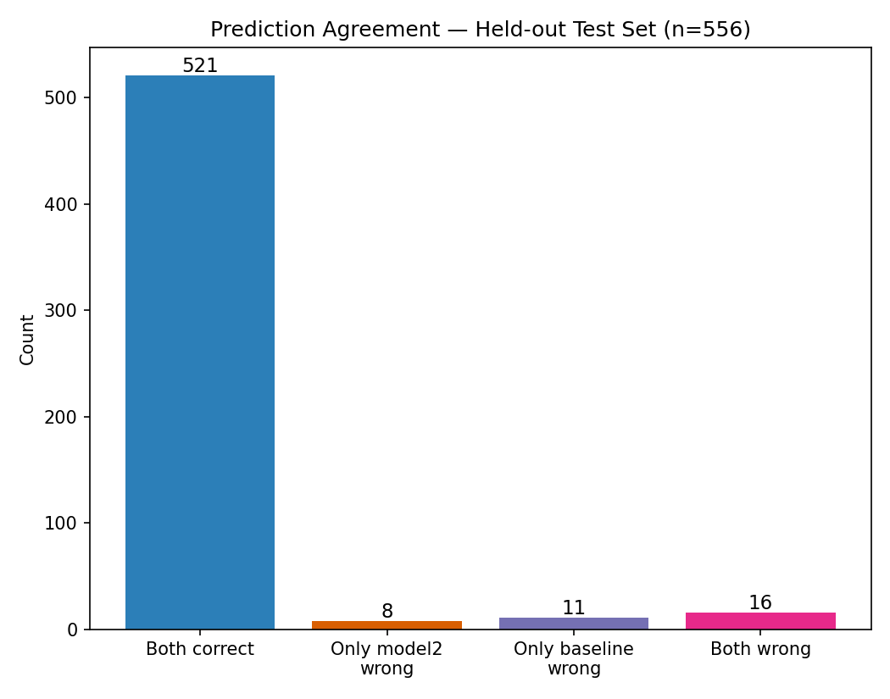

# PubMed Abstract Classification: Neoplasms vs. Cardiovascular Diseases

A small, end-to-end text-classification project with the emphasis on **evaluation rigor** rather than leaderboard chasing: cleaning decisions are documented, performance is reported with confidence intervals, and a more complex model is compared to a simple baseline with paired significance tests.

**Task:** given the title and abstract of a PubMed paper, predict whether it belongs to the *Neoplasms* or *Cardiovascular Diseases* MeSH category (binary classification).

## Headline results

| | Baseline | Model 2 |
|---|---|---|
| Pipeline | TF-IDF → Logistic Regression | TF-IDF → TruncatedSVD (200) → Gradient Boosting |
| CV accuracy (5-fold, train set) | **95.7%** (95% CI 94.4–96.9) | 94.1% (95% CI 92.3–95.8) |
| CV ROC-AUC | 0.993 | 0.985 |
| Held-out test accuracy (n=556) | 95.1% | 95.7% |
| Held-out test ROC-AUC | 0.990 | 0.989 |

- **Cross-validation:** Model 2 scored lower than the baseline on all 5 folds (mean difference −1.6 points, paired t-test p = 0.0034).
- **Held-out test set:** Model 2 is nominally higher, but McNemar's test finds the difference indistinguishable from chance (8 vs. 11 disagreements, p = 0.65).
- **Conclusion:** the added complexity buys no reliable improvement, so the simpler, better-calibrated baseline is preferred. See [Caveats](#caveats) for how much weight the p-values can bear.

## Approach

### 1. Data and cleaning (`src/01_clean_and_load.py`)
Raw pull: 2,924 abstracts (columns: `pmid, title, abstract, journal, year, label`), loaded into SQLite via pandas. Issues found and how each was handled:

| Issue | Handling |
|---|---|
| 58 PMIDs appear under **both** categories (e.g. cardio-oncology papers), so the label is genuinely ambiguous | Dropped (116 rows). A deliberate modeling decision; treating them as multi-label is a possible extension |
| 29 truncated/corrupted abstracts (< 100 chars) | Dropped |
| 13 missing titles, 8 missing years | Kept as NULL (not used as features) |

Result: **2,779 abstracts**, nearly balanced (1,376 Neoplasms / 1,403 Cardiovascular).

### 2. Evaluation protocol
- Stratified 80/20 split; the 20% test set (n=556) is untouched until the final check.
- Stratified 5-fold CV on the training set (n=2,223), reporting mean ± 95% t-based CI per metric.
- **Same split and fold assignment for both models**, so comparisons are paired.
- Accuracy is the primary metric: classes are balanced and neither error type is costlier. F1 and ROC-AUC are reported alongside.

### 3. Models
- **Baseline** (`src/02_baseline_model.py`): TF-IDF over unigrams + bigrams (20k features, English stop words removed) → L2 logistic regression.
- **Model 2** (`src/03_train_model2.py`): same TF-IDF → TruncatedSVD to 200 dense components (LSA) → `HistGradientBoostingClassifier`. Chosen as a structurally different approach (dense embedding + nonlinear trees) using only local, scikit-learn-native tools.

### 4. Model comparison (`src/04_compare_models.py`)
Two paired tests, because they answer different questions:
- **Paired t-test** on matched per-fold CV accuracies: is the typical gap across resamples distinguishable from zero?
- **McNemar's test** on held-out predictions (exact binomial when discordant pairs < 25): among examples where the models disagree, does one win more than chance?

### 5. Robustness to random seed (`src/06_seed_robustness.py`)
The whole CV comparison was repeated under 5 seeds:

| seed | mean diff (model2 − baseline) | paired t-test p |
|---|---|---|
| 42 | −1.62 pts | 0.0034 |
| 0 | −1.35 pts | 0.0111 |
| 7 | −1.31 pts | 0.0417 |
| 123 | −0.99 pts | 0.1534 |
| 999 | −1.08 pts | 0.2008 |

Model 2 is worse in **5/5** seeds, but the result crosses p < 0.05 in only **3/5**. The direction of the effect is stable; the significance verdict is not.

## Error analysis (`src/05_error_analysis.py`)





- **Errors are not random.** Manually inspecting misclassified abstracts, they cluster at genuine oncology–cardiology overlap: cancer-associated thrombosis, checkpoint-inhibitor myocarditis, hematologic papers that share vocabulary with both fields.
- **Baseline errors sit near the decision boundary** (predicted probability ≈ 0.5), i.e. it is uncertain where the text is ambiguous. **Model 2 is far more overconfident**: its probabilities pile up at 0 and 1, including on its mistakes, which is a second reason to prefer the baseline.
- **The models make different mistakes.** Of 35 distinct errors, only 16 are shared (11 baseline-only, 8 Model 2-only), so Model 2's errors are not simply a superset of the baseline's.

## Caveats
- **The task is lexically easy.** Neoplasm and cardiovascular vocabularies barely overlap, so ~95% accuracy is expected and leaves little headroom. The value here is in the evaluation, not the score.
- **CV folds share training data**, so they are not fully independent; the t-test CI/p-value is somewhat optimistic. With only 5 folds the p-value is also noisy (see the seed table).
- **Uncertainty is within-dataset only.** CV quantifies variation from resampling this fixed dataset, not from drawing a fresh sample of PubMed abstracts. Generalization to a new pull is plausible but untested.
- **No pretrained embeddings or transformers**; Model 2 deliberately stays within local scikit-learn tooling. A fine-tuned biomedical language model (e.g. a PubMedBERT-style model) would be the natural next comparison.
- Labels come from MeSH indexing, which has its own noise (some "errors" may be label errors).

## Reproducing

```bash
python -m venv .venv && source .venv/bin/activate
pip install -r requirements.txt

# Place the raw data at data/raw/pubmed_abstracts.csv
# (columns: pmid, title, abstract, journal, year, label; label is category_a = Neoplasms, category_b = Cardiovascular Diseases)

python src/01_clean_and_load.py      # -> data/processed/pubmed.db
python src/02_baseline_model.py      # -> results/baseline_cv_scores.csv, models/baseline_pipeline.joblib
python src/03_train_model2.py        # -> results/model2_cv_scores.csv, models/model2_pipeline.joblib
python src/04_compare_models.py      # paired t-test + McNemar's test
python src/05_error_analysis.py      # -> results/figures/*.png
python src/06_seed_robustness.py     # -> results/seed_robustness.csv
```

All scripts use fixed seeds and are deterministic; rerunning reproduces the numbers above. Runtime is a few minutes on a laptop (the seed-robustness script is the slowest).

## Repository layout

```
├── README.md
├── requirements.txt
├── data/            raw/ and processed/ are git-ignored (see note below)
├── models/          fitted pipelines (git-ignored)
├── results/
│   ├── baseline_cv_scores.csv, model2_cv_scores.csv, seed_robustness.csv
│   └── figures/
└── src/
    ├── config.py    shared paths and constants
    └── 01_… to 06_… scripts, run in order
```

**Data note:** the raw abstracts are not committed. PubMed abstract text is owned by publishers and distributed under NLM's terms, so the repo ships code and derived statistics only. The data can be re-pulled via NCBI E-utilities (Entrez) by searching each MeSH category and fetching title/abstract records.

*Author: Anastasia Fokina*
